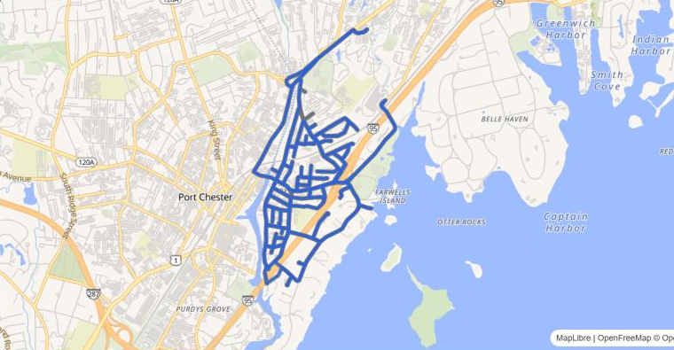
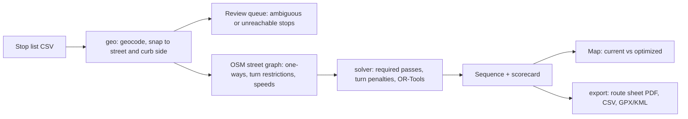

# Starboard Routing

[](https://github.com/var-flotsam/routesmith/actions/workflows/ci.yml)
[](https://github.com/var-flotsam/routesmith/actions/workflows/pages.yml)
[](LICENSE.md)

Starboard Routing re-sequences residential waste collection routes for
automated side-loader trucks, whose single arm can only reach carts on the
truck's right. It takes a hauler's current stop list and works out an order of
street passes that keeps every cart on the right, never drives the wrong way on
a one-way street, keeps left turns and U-turns rare, and minimizes total drive
time.

**[Open the live demo](https://var-flotsam.github.io/routesmith/)** — one public
route, result computed in advance; nothing is solved in your browser.

[](https://var-flotsam.github.io/routesmith/)

## What the demo shows

Byram, Greenwich, Connecticut: 754 public address points, of which 714 snap to
a street and 40 go to a planner's review queue. The current route is synthetic:
a side-loader working a stop list drawn for a rear-loader, so it collects both
curbs on one pass and reaches left-side carts either by going round the block
or by the driver getting out. One truck, one yard, one disposal site.

| | Current | Optimized | Change |
| --- | ---: | ---: | ---: |
| Route time | 7.34 h | 4.63 h | −2.72 h |
| Driving | 3.47 h | 1.71 h | −1.76 h |
| Wrong-side extra | 0.96 h | 0.00 h | −0.96 h |
| Distance | 68.3 km | 39.2 km | −29.1 km |
| Dead-head distance | 38.8 km | 14.3 km | −24.5 km |
| Left turns | 99 | 38 | −61 |
| U-turns | 116 | 32 | −84 |
| Wrong-side pickups | 54 | 0 | −54 |
| Street passes | 613 | 350 | −263 |
| Stops serviced | 714 | 714 | 0 |

Every number comes from `data/demo/result/shared-run.json`, which the worker
writes and a test checks against the committed inputs. The demo page animates
both routes through the day and shows the same scorecard.

## How it works



- **geo** fetches the street network from OpenStreetMap, snaps each stop to a
  street segment and a curb side, and records the OSM snapshot date. Anything
  it cannot place with confidence becomes a review item with a reason; the
  importer never raises on user data.
- **solver** is pure: it takes a graph and stops and returns a sequence and a
  scorecard, with no I/O. Each street with carts becomes a set of required
  passes; the solver orders them with Google OR-Tools so that every serviced
  cart is on the truck's right, no pass goes against a one-way, forbidden
  U-turns are never taken, and the route starts and ends at the yard with
  disposal visits whenever capacity needs them. Turn penalties and speeds are
  tunables in `packages/solver/defaults.py`, each with a reason and a citation.
  These invariants are property-tested with Hypothesis on random street grids.
- **export** writes a printable driver route sheet, a CSV of stops in the new
  order, and a GPX/KML path, deterministically: the same run gives the same
  bytes.
- **api**, **worker** and **web** wrap those packages: FastAPI with organization
  scoping on every query, an arq worker for imports and solves, and a
  React + MapLibre app that shows the current route against the optimized one.

## Run it locally

Needs Docker Desktop (with WSL2 on Windows). From the repository root:

1. If the Overpass API is out of reach from your network, put an OpenStreetMap
   extract (a Geofabrik `.osm.pbf` for your state) under `cache/osm/extracts/`
   and name it in a `.env` file at the repository root, for example
   `STARBOARD_OSM_EXTRACT=/app/cache/osm/extracts/connecticut-latest.osm.pbf`.
   `cache/` and `.env` stay out of git.
2. `docker compose up --build` starts the database, Redis, the API, the worker
   and the web app. The first start builds the image and installs the web
   dependencies, which takes a few minutes.
3. In a second terminal, `docker compose run --rm api python -m starboard.api.demo you@example.com`
   preloads the Byram demo route for that email.
4. Open http://localhost:5173 and ask for a sign-in link with the same email.
   Running locally, no email is sent: `docker compose logs api` prints the link.
   Open it in the same browser.
5. Open Demo, then Byram (demo). The stop list is snapped in the background;
   the first time, the worker downloads the street network for the area. Clear
   any stops in review, then press Solve.

`docker compose down` stops everything. Data stays in Docker volumes until
`docker compose down -v`.

Without Docker, the CLI runs the solver on the demo stops directly:

```
uv sync --all-packages
uv run starboard score data/demo/stops.csv      # scorecard of the current route, no solve
uv run starboard optimize data/demo/stops.csv   # full run
```

## Tests and CI

```
uv run pytest                                   # all Python tests
uv run pytest packages/solver -m property       # solver invariants only
uv run ruff check . && uv run ruff format --check . && uv run mypy
(cd apps/web && pnpm test && pnpm lint && pnpm typecheck)
```

CI runs all of the above against a PostGIS service, plus secret scanning and a
banned-terms check, on every pull request. The static demo is built on every
pull request and deployed to GitHub Pages from `main`
([ADR-0007](docs/adr/0007-static-demo.md)).

## Repository layout

| Path | What it is |
| --- | --- |
| `packages/solver` | Pure solver: graph + stops in, sequence + scorecard out |
| `packages/geo` | OpenStreetMap access, geocoding, snapping; the only network I/O |
| `packages/export` | Route sheet PDF, CSV, GPX/KML |
| `apps/api` | FastAPI service, organization-scoped |
| `apps/worker` | arq jobs: imports, solves, the committed demo result |
| `apps/web` | React + MapLibre app, and the static demo build |
| `apps/cli` | `starboard score` and `starboard optimize` |
| `data/demo` | The public demo stops and their provenance |
| `docs/adr` | Architecture decision records |

Python 3.12 with `uv`; TypeScript with `pnpm`. Licence: FSL-1.1-ALv2
(`LICENSE.md`). Map data © OpenStreetMap contributors, ODbL.
