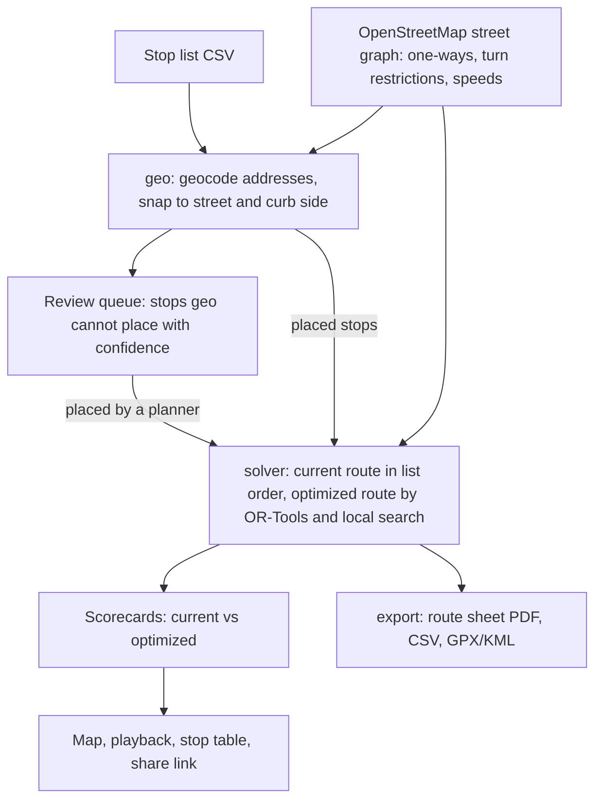

# Starboard Routing

[](https://github.com/var-flotsam/routesmith/actions/workflows/ci.yml)
[](https://github.com/var-flotsam/routesmith/actions/workflows/pages.yml)
[](LICENSE.md)

Starboard Routing re-sequences residential waste collection routes for automated
side-loader trucks, whose single arm can only reach carts on the truck's right.
It is for haulers that have bought side-loaders but still run the routes they
drew for rear-loaders. It takes a hauler's current stop list and searches for
the order of street passes with the least route time that keeps every cart on
the right, never drives the wrong way on a one-way street, and makes U-turns
only where they are allowed: at dead ends and, by default, where quiet streets
with few carts meet. Every turn adds time to the route, left turns and U-turns
the most, so the search avoids them where it can. It reports the best order it
found and a bound on how far that can be from the best possible.

**[Open the live demo](https://var-flotsam.github.io/routesmith/)**: one route
on public address data, with a synthetic current route and an optimized route
computed in advance; nothing is solved in your browser.

[](https://var-flotsam.github.io/routesmith/)

Basemap: [OpenFreeMap](https://openfreemap.org/), [© OpenMapTiles](https://www.openmaptiles.org/).
Map data [© OpenStreetMap contributors](https://www.openstreetmap.org/copyright).

## Status

Starboard Routing runs on your own machine under Docker Compose (see
[Run it locally](#run-it-locally)). It is not hosted anywhere and there is
nothing to sign up for; the demo above is a static page. Sign-in is by a
one-time link, which the API prints in its log because no mail service is
connected. Sign-in with GitHub or Google, billing and a hosted deployment are
not built yet.

## What the demo shows

Byram, Greenwich, Connecticut: 754 public address points. 714 snap to a street;
the other 40 would wait in a planner's review queue (31 with no street near
enough, 9 about as near one street as another), and the demo leaves them out of
both routes. One truck, carrying 420 carts a load, starts and ends at
Greenwich's transfer station, which is also where it unloads
([`data/demo/PROVENANCE.md`](data/demo/PROVENANCE.md)).

The current route is synthetic. Its stop list is drawn for a rear-loader, whose
crew collects both curbs on one pass of each street. A side-loader works that
list: for a cart on its left, the truck goes round to reach it from the right,
or the driver gets out to bring it to the arm (a wrong-side pickup), whichever
is quicker. The rear-loader order is a well-drawn one, so the saving shown is a
conservative one.

| | Current | Optimized | Change |
| --- | ---: | ---: | ---: |
| Route time | 7.34 h | 4.63 h | −2.72 h |
| Driving | 3.47 h | 1.71 h | −1.76 h |
| Collecting carts | 2.38 h | 2.38 h | 0.00 h |
| Wrong-side extra | 0.96 h | 0.00 h | −0.96 h |
| Unloading | 0.53 h | 0.53 h | 0.00 h |
| Distance | 68.3 km | 39.2 km | −29.1 km |
| Dead-head distance | 38.8 km | 14.3 km | −24.5 km |
| Left turns | 99 | 38 | −61 |
| Right turns | 151 | 105 | −46 |
| U-turns | 116 | 32 | −84 |
| Wrong-side pickups | 54 | 0 | −54 |
| Street passes | 613 | 350 | −263 |
| Disposal visits | 2 | 2 | 0 |
| Stops serviced | 714 | 714 | 0 |

Route time is driving, collecting carts, wrong-side extra and unloading added
up. The times are modelled, not measured: driving uses each street's
OpenStreetMap speed limit, or a default speed for its kind of road, plus a time
cost for every turn; each cart takes 12 s to collect, each wrong-side pickup
64 s more, and each disposal visit 16 min. A street pass is one drive along one
street segment in one direction, collecting or dead-heading. Each figure is
rounded on its own, so sums and changes can be 0.01 h off.

The table is the demo page's scorecard, from `data/demo/result/shared-run.json`;
the stop counts come from `about.json` in the same folder. The worker's own code
builds both by snapping and solving the stops
([`PROVENANCE.md`](data/demo/PROVENANCE.md) gives the command), and a test fails
if the demo's stops or route change without a rebuild. The demo page also plays
both routes through the day on one clock.

## How it works



- **geo** reads the stop list, geocodes stops given only by an address with the
  US Census Bureau's free geocoder (US addresses only;
  [ADR-0005](docs/adr/0005-geocoder.md)), fetches the street network from
  OpenStreetMap through Overpass or a local extract, snaps each stop to a street
  segment and a curb side, and records the OSM snapshot date. A row it cannot
  read is rejected with a reason. A stop it cannot place with confidence (such
  as no street near enough, two streets about as near, a cart on the left of a
  one-way street, or an address the geocoder could not find) becomes a review
  item with a reason. Bad data in an upload never crashes the import.
- **solver** is pure: it takes the street graph and the placed stops and returns
  the current and optimized routes, each with a scorecard, with no I/O. The
  current route works the stop list street by street, in list order, by the
  quickest legal way. For the optimized route, each curb with carts becomes a
  required pass in the direction that puts it on the truck's right; Google
  [OR-Tools](https://developers.google.com/optimization) orders the passes and
  a local search (2-opt and or-opt moves) improves the order. Every serviced
  cart is on the truck's right, no pass goes against a one-way, no forbidden
  U-turn is taken, and the route leaves the yard, never overfills the truck,
  unloads after the last pass, and returns to the yard. These rules are
  property-tested with [Hypothesis](https://hypothesis.readthedocs.io/) on
  random street grids. Drive time uses each street's OpenStreetMap speed limit
  where it has one; the turn costs, the speeds for streets without one, and the
  solver's other tunables live in
  `packages/solver/src/starboard/solver/defaults.py`, each with a reason and,
  where one exists, a public source.
- **several trucks**: an area can be split among N trucks (`--trucks N`; by
  default one truck per current route in the stop list, and at least one per
  1,000 stops). The solver divides the streets into compact districts, one per
  truck, routes each, then moves streets between neighbouring districts to even
  out the route times and lower the total. Every stop it can serve is on
  exactly one route, and every route starts and ends at the shared yard and
  uses the shared disposal site ([ADR-0003](docs/adr/0003-multi-route.md)).
- **export** writes a printable driver route sheet (step by step: turn, street,
  distance, carts), a CSV of stops in the new order, and GPX and KML paths,
  deterministically: the same run gives the same bytes.
- **api**, **worker** and **web** wrap those packages: FastAPI with organization
  scoping on every query, an arq worker for imports and solves, and a
  React + MapLibre app with the review queue on a map and a comparison page:
  current and optimized routes on one map or side by side, playback, the
  scorecard, a stop table, downloads and a read-only share link.

A stop list is a UTF-8 CSV with `stop_id`, `current_sequence`, and either `lon`
and `lat` or an address (`address`, or `house_number` and `street`, with
optional `city`, `state` and `zip`). An optional `route_id` column, filled on
every row, names the truck route each stop is on today.
[`data/demo/stops.csv`](data/demo/stops.csv) is an example.

## Run it locally

Needs Docker with Compose (Docker Desktop with WSL2 on Windows), with ports
5173, 8000, 5432 and 6379 free. From the repository root:

1. On Linux, first run `mkdir -p cache/osm/extracts && chmod -R a+w cache`.
   The API and worker run as user 1000 and write in `cache/`, which Docker
   would otherwise create as root.
2. If the Overpass API is out of reach from your network, download the
   Geofabrik extract for the state your stops are in (for the demo,
   [Connecticut](https://download.geofabrik.de/north-america/us/connecticut-latest.osm.pbf))
   into `cache/osm/extracts/` and name it in a `.env` file at the repository
   root: `STARBOARD_OSM_EXTRACT=/app/cache/osm/extracts/connecticut-latest.osm.pbf`.
   `cache/` and `.env` stay out of git.
3. `docker compose up --build` starts the database, Redis, the API (port 8000),
   the worker and the web app (port 5173). The first start builds the image and
   installs the web dependencies, which takes a few minutes.
4. In a second terminal, `docker compose run --rm api python -m starboard.api.demo you@example.com`
   preloads the demo for that email: an organization named Demo with the route
   Byram (demo) and its stop list.
5. Open http://localhost:5173 and ask for a sign-in link with the same email.
   No email is sent: `docker compose logs api` prints the link. Open it in the
   same browser.
6. Open Demo, then Byram (demo). Under Stop lists, `stops.csv` shows
   processing while the worker snaps it; the first time, the worker also
   fetches the street network for the area, which takes a few minutes. When it
   shows ready, the number under In review opens the review queue: put each
   stop on one of the streets offered, or press Leave this stop out. Once the
   queue is clear, press Solve; a solve also takes a few minutes.

Your numbers can differ a little from the table above: the demo result uses
OpenStreetMap as of 23 October 2026 and leaves out every stop in review, and a
local run uses the streets as fetched that day.

`docker compose down` stops everything. The database stays in a Docker volume
until `docker compose down -v`. Uploaded stop lists, geocoder answers and street
networks are kept in `cache/` in the checkout, which `down -v` leaves alone;
delete `cache/uploads/` and `cache/geocode/` to remove them.

Without Docker, the CLI snaps and solves a stop list on the command line and
prints the scorecards, with no database, map or review queue. It reads only
stops with `lon` and `lat` (it does not geocode) and leaves out stops that would
go to review. It needs [uv](https://docs.astral.sh/uv/), which fetches Python
3.12 if needed. `data/demo/route.json` gives the yard, the disposal site and
the truck:

```
uv sync --all-packages
uv run starboard score data/demo/stops.csv --route data/demo/route.json      # the current route's scorecard, no solve
uv run starboard optimize data/demo/stops.csv --route data/demo/route.json   # current and optimized, side by side
```

The first run fetches the street network for the area from Overpass and caches
it under `cache/osm/`. If Overpass is out of reach, add
`--osm-extract https://download.geofabrik.de/north-america/us/connecticut-latest.osm.pbf`;
the CLI downloads the extract into `cache/osm/extracts/` and builds the network
from it. `optimize --trucks N` splits the area among N trucks.

## Tests and CI

```
uv run pytest -m "not demo and not benchmark"   # the Python tests CI runs
uv run pytest packages/solver -m property       # property tests of one route's hard constraints
uv run ruff check . && uv run ruff format --check . && uv run mypy
(cd apps/web && pnpm install && pnpm test && pnpm lint && pnpm typecheck)   # pnpm through corepack
```

Most API tests need a PostGIS database of their own, named by
`STARBOARD_TEST_DATABASE_URL`, and are skipped without one. They empty it
before each test, so never point them at the Compose stack's `starboard`
database. `-m demo` runs the demo-town tests, which need the OSM street
network; `-m benchmark` runs the scale runs of 1,000 to 10,000 stops.

On every pull request and every push to `main`, CI runs the checks above (the
Python tests against a PostGIS service), plus secret scanning, a banned-terms
check, a UTF-8 check, a check that the web app's API types match the API, and a
Compose start of the API and worker. It also builds the static demo, which the
`pages` workflow deploys to GitHub Pages from `main`
([ADR-0007](docs/adr/0007-static-demo.md)).

## Repository layout

| Path | What it is |
| --- | --- |
| `packages/solver` | Pure solver: graph + stops in, routes + scorecards out |
| `packages/geo` | OpenStreetMap access, geocoding, snapping; the only code that calls OpenStreetMap or a geocoder |
| `packages/export` | Route sheet PDF, CSV, GPX/KML |
| `apps/api` | FastAPI service, organization-scoped |
| `apps/worker` | arq jobs for imports and solves, and `demo_result`, which rebuilds the committed demo result |
| `apps/web` | React + MapLibre app, and the static demo build |
| `apps/cli` | `starboard score` and `starboard optimize` |
| `data/demo` | The public demo stops, the demo's yard, disposal site and truck, their provenance, and the demo result |
| `docs/adr` | Architecture decision records |

Python 3.12 with `uv`; TypeScript with `pnpm`.

Licence: FSL-1.1-ALv2 ([`LICENSE.md`](LICENSE.md)): source-available, no
competing commercial use, and each version becomes Apache-2.0 two years after
its release. Two folders keep their own licences
([ADR-0001](docs/adr/0001-licence.md)): `data/demo/result/`, which is derived
from OpenStreetMap, is under the ODbL 1.0, and the route sheet's DejaVu Sans
fonts in `packages/export/src/starboard/export/fonts/` are under the font
licence in that folder. Map data © OpenStreetMap contributors, ODbL. The demo's
address points are public domain.
